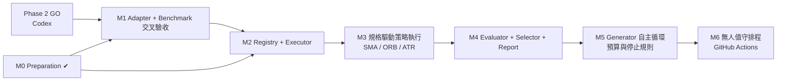

# Phase 3 Implementation Plan

| 項目 | 內容 |
|---|---|
| 文件版本 | v1.0（2026-11-03） |
| 前置條件 | Phase 2（`market-research-core` PR #1）Drive smoke PASS、合併、取得正式 SHA，判定 GO |
| 本階段成果 | 架構、規格 schema＋validator、12 案例 benchmark oracle、評估函式庫、整合契約 — 皆不依賴 Phase 2 API |
| 邊界 | 不修改 `market-research-core`、不碰 Codex 分支、不實作真實交易 |

---

## 1. 本次完成（M0 — Preparation）

| 交付 | 位置 | 驗證 |
|---|---|---|
| Strategy Agent 架構 | `STRATEGY_AGENT_ARCHITECTURE.md` | 文件審閱 |
| Strategy Spec schema + 3 範例 | `STRATEGY_SPEC_SCHEMA.json`、`specs/examples/` | 3 範例通過；S01–S16 與結構性 look-ahead 規則各有負面測試 |
| Validator | `src/strategy_agent/spec/validate.py` | `tests/test_spec_validation.py` |
| Benchmark oracle（12 案例） | `BENCHMARK_TEST_CASES.md`、`benchmark/` | 手算＝oracle 逐位一致；8 個 mutant 全被抓出 |
| 交叉驗收 harness | `benchmark/harness/crosscheck.py` | `tests/test_harness.py` |
| 評估函式庫 | `src/strategy_agent/evaluation/` | 手算值與性質測試 |
| 評估規約 | `QUANT_EVALUATION_PROTOCOL.md` | 文件審閱 |
| Ports（整合契約程式化） | `src/strategy_agent/ports.py` | `tests/test_ports_and_registry.py` |
| Registry 紀錄 schema | `schemas/EXPERIMENT_RECORD_SCHEMA.json` | 同上 |
| 測試總數 | `pytest -q` | 78 passed（Python 3.11／3.12 CI） |

---

## 2. 里程碑與相依關係

| 里程碑 | 內容 | 相依 | 驗收標準 |
|---|---|---|---|
| **M1** Adapter + 交叉驗收 | `adapters/mrc_adapter.py` 實作 `MarketDataPort`／`BacktestPort`；跑 B01–B12 | Phase 2 GO；§5 待確認事項 Q1–Q4 有答案 | B01–B10、B12 PASS（B11 依 Q5）；`check_report` 通過；結果與三個 SHA 寫入 Registry |
| **M2** Registry + Executor | JSONL Registry（append-only、schema 驗證）、holdout lock、預算控制、重試政策 | M0 | 拒絕修改既有紀錄；第二次讀 holdout 被擋；預算用完寫 `BUDGET_EXCEEDED` |
| **M3** 規格驅動執行 | 把 Spec 的指標／規則轉成訊號序列（Phase 3 端，純函式、不看未來），交給引擎執行；或由 Codex 在引擎端支援 spec（擇一，見 Q6） | M1、M2 | 3 個範例規格在真實快照上可重現執行；訊號層以 B02、B08、B12 類型的合成測試覆蓋 |
| **M4** Evaluator + Selector + Report | walk-forward 執行器、Gate G1–G11、報告模板、Notion 摘要 | M3 | 範例規格產出完整報告，含拒絕原因；重跑報告完全一致 |
| **M5** Generator 自主循環 | LLM 產生 DRAFT 規格 → Validator → 佇列；family 合併；每輪上限 | M4 | 一次完整無人循環：≥ 3 個規格（含被拒），Registry 帳本完整，不碰 holdout |
| **M6** 排程 | GitHub Actions 夜間批次（Drive 唯讀 + 本機驗證副本）、失敗通知 | M5 | 連續 7 天無人值守，所有失敗皆有紀錄與通知 |

---

## 3. 本 repo 下一步（不需等待 Phase 2）

1. M2 Registry（JSONL + schema 驗證 + holdout lock）——完全不依賴 Phase 2。
2. 訊號層純函式（SMA／EMA／ATR Wilder／opening range），以合成資料測試「不看未來」：任何 `t` 的訊號只依賴 `available_at ≤ t` 的資料（截斷測試：刪除 `t` 之後資料，訊號不變）。
3. Benchmark v2 案例：手續費取整與最低 20 元、期交稅四捨五入、台股 tick 跳級、IBKR DST 與 UTC 轉換、訂單逾期 `ORDER_EXPIRED`。

---

## 4. Phase 2 完成後的驗收清單

**資料層**
- [ ] `MarketDataClient` 對 IBKR、TXF、TW 三市場以正式 Drive 快照載入成功（Phase 2 Colab smoke PASS 紀錄）
- [ ] 回傳 provenance 含 snapshot ID、producer SHA、verdict、exclusions、來源檔、列數
- [ ] Bar frame 滿足 C1（含 side-specific 成交資格）——或 Q3 決定由 adapter 從 `buy_eligibility`／`sell_eligibility` 推導
- [ ] 每個市場的 `available_at` 語意有單元測試（C2）
- [ ] IBKR／TXF 的 eligibility 不再一律為 `True`；session 不再為 `UNKNOWN`（或明確文件化）

**回測層**
- [ ] B01–B10、B12 PASS；B11 依 Q5 結論
- [ ] provenance 的 `engine_git_sha` 為真實 commit SHA
- [ ] 訂單有效期（TIF）有明確規則，不會在數日後才成交
- [ ] 期貨成本：每口固定費用、期交稅；資金檢查用保證金而非全額名目
- [ ] 台股賣方證交稅預設值（目前 `sell_tax_rate=0.0`）由市場決定，不靠呼叫端記得設定
- [ ] 指標不跨 exclusion 窗、不跨合約、不使用 `backtest_eligible=False` 的 K 棒
- [ ] 期末未平倉以 `open_position` 回報

**治理**
- [ ] 結果寫入 Registry，含 Phase 2 SHA、adapter SHA、本 repo SHA
- [ ] Notion 子頁更新驗收結果

---

## 5. Phase 2 介面風險與待確認事項（建議，不修改 Codex 程式碼）

所有行號參照 `market-research-core@16281b2`（`feature/phase2-unified-data-backtest`，PR #1 open）。這些是閱讀程式碼後的觀察，**不代表 Phase 2 有錯**；Phase 2 本身定位是 integration probe，多數項目是「Phase 3 要用之前需要補的契約」。

| # | 風險 | 證據 | 影響 | 建議 | 嚴重度 |
|---|---|---|---|---|---|
| R1 | IBKR／TXF 的四種 eligibility 一律設為 `True` | `client.py:107-110` | 無法表達時段外、零量或其他不可成交狀態；B04／B05 類錯誤無法被引擎攔下 | 依 session 日曆與 volume 設定 `execution_eligible`；或文件化「由策略層判斷」 | 高 |
| R2 | IBKR／TXF `session` 為 `UNKNOWN` | `client.py:105-106` | RTH／ETH、日盤／夜盤無法區分；TSM 規格需 RTH | adapter 補 session 標記，或在 Phase 2 契約加入 | 中 |
| R3 | 台股 `execution_eligible` 同時要求 `buy_eligibility` 與 `sell_eligibility` | `taiwan.py:211-212` | 漲停鎖死時連賣單也被擋（B07 期望賣單可成交）；持有部位可能被困 | 提供 side-specific 欄位 `buy_execution_eligible`／`sell_execution_eligible` | 高 |
| R4 | `available_at = timestamp + 1 分`假設所有 1m 來源都是「開始時間」標記 | `client.py:111-113` | 若 Fubon TXF 以結束時間標記，會造成 1 根 K 棒的 look-ahead | 以開盤第一根（TXF 08:45／TWSE 09:00／NYSE 09:30）實證確認並加測試 | 高（待確認） |
| R5 | 收盤集合競價 13:30 棒 `available_at = timestamp`（+0） | `taiwan.py:217` | 其他棒是 +5 分；需確認 13:30 標記是否代表撮合完成時間 | 文件化或加測試 | 低 |
| R6 | SMA 以全部列滾動計算，包含 `backtest_eligible=False` 的列，且 IBKR exclusion 列被移除後視窗跨越缺口 | `backtest.py:39-40`；`ibkr.py:62` | 訊號可能使用不合格資料；跨 exclusion 窗的指標違反 Notion §13.3 | 指標只用合格列、遇 exclusion／換合約重置 | 中 |
| R7 | 訂單沒有有效期限：找「之後第一根合格棒」不限時間 | `backtest.py:48-61` | 訊號可能在數日後才成交（stale fill） | 定義 TIF（本規約：到下一個 session 結束） | 中 |
| R8 | 成本只有比例手續費；期貨乘數下以全額名目檢查現金 | `backtest.py:46,70,73`；`models.py:85` | TXF 1 口名目約 400 萬 > 預設 100 萬資金 → 每次 `INSUFFICIENT_CASH`；無法表達每口費用與期交稅 | 成本模型對齊 Spec `costs`；期貨用保證金 | 高（用於期貨時） |
| R9 | 台股 `sell_tax_rate` 預設 0.0 | `models.py:86` | 忘記設定即高估績效 0.3%／趟 | 依市場給預設值，或強制必填 | 中 |
| R10 | provenance 的引擎版本是套件版本，source 安裝時為 `0.2.0+source` | `backtest.py:15-19,108` | 無法重現到 commit | 寫入 git SHA | 中 |
| R11 | 期末未平倉不另行回報；`trade_count` 只計 SELL | `backtest.py:93-115` | 未平倉損益混入總報酬但不在交易統計中 | 回報 `open_position`（mark 與清算估計分開） | 低 |
| R12 | PIT `shift(1)` 以 universe panel 的「前一列」而非「前一交易日」 | `taiwan.py:188` | panel 若有缺日，前一列可能是更早的日期 | 依交易日曆 shift，或驗證 panel 無缺日 | 低（待確認） |

### 5.1 待確認事項（需資料擁有者／Codex 回覆）

| # | 問題 | 影響的元件 |
|---|---|---|
| Q1 | Fubon TXF 1m 與台股 5m 的時間戳記是 K 棒開始還是結束？ | C2、R4、所有 TXF／TW 案例 |
| Q2 | IBKR TSM normalized parquet 是否只含 RTH？若含 ETH，session 欄位如何標記？ | R2、ATR 範例規格 |
| Q3 | Side-specific 成交資格由 Phase 2 提供，還是由 Phase 3 adapter 從 `buy_eligibility`／`sell_eligibility` 推導？ | C1、R3 |
| Q4 | Phase 2 引擎是否要擴充為接受「訊號序列 + 成本規格」的一般執行器，或 Phase 3 自建執行層、Phase 2 只提供資料？ | M3 範圍 |
| Q5 | 持有部位遇到 exclusion 窗：(a) 整筆失效、(b) 窗前強制平倉、(c) 剔除跨窗報酬？ | B11、C5 |
| Q6 | 實際券商手續費率、最低手續費、期貨每口費用（TXF、NQ、ES）以哪份文件為準？ | 範例規格 costs |
| Q7 | Final Holdout 起始日期（每個資料集）由誰決定、何時登錄？ | §2 評估規約 |

---

## 6. 不能（或不應）自主化的部分

- Holdout 邊界設定、評估門檻（Gate）變更、資料快照升級
- 任何 Zone X（交易執行）設計與 paper trading 啟動
- 修改會存取憑證的 Workflow、合併 PR
- 授權／登入失效（Fubon、FinLab、IBKR）時的處理
- 判斷 B11 類政策問題

---

## 7. 風險與緩解（Phase 3 自身）

| 風險 | 緩解 |
|---|---|
| Agent 透過改名、小改規則規避試驗計數 | family 合併規則（canonical hash + 規則結構）；DSR 用原始 N |
| LLM 生成規格含隱性 look-ahead | Schema 讓多數 look-ahead 無法表達；訊號層截斷測試；benchmark |
| 引擎更新造成結果漂移 | 引擎 SHA 必須有 BENCHMARK_PASS；每週 5% 重現性抽查 |
| 樣本太小卻下結論 | MinTRL 與 `EXPLORATORY` 標記；TXF 結果不可單獨入選 |
| 計算成本失控 | family／每日預算、wall-time 上限，用完即停並回報 |
