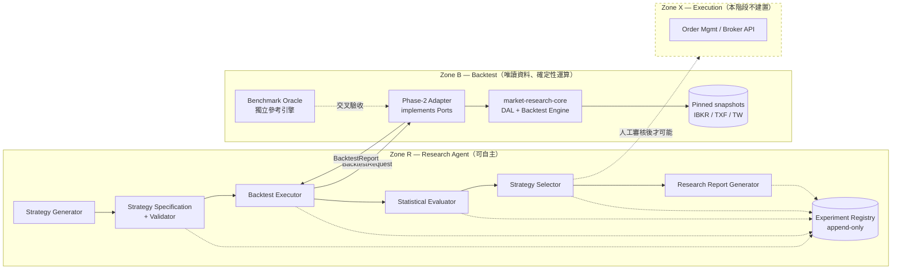
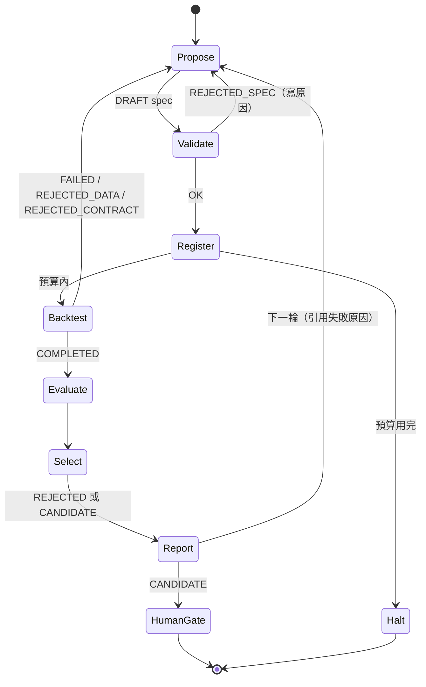

# Strategy Agent Architecture — Phase 3 Preparation

| 項目 | 內容 |
|---|---|
| 文件版本 | v1.0（2026-11-03） |
| 狀態 | **DESIGN READY／未接 Phase 2**。本 repo 只含設計、規格、獨立 oracle 與評估函式庫；沒有呼叫任何 Phase 2 API。 |
| 相依基準 | `market-research-core` `main@aadedf0`（Phase 1 GO）；Phase 2 參考 `feature/phase2-unified-data-backtest@16281b2`（PR #1 open，Drive smoke 未執行 → **未確認介面**） |
| 本 repo | `hh4832/strategy-research-agent` |
| 相關文件 | `STRATEGY_SPEC_SCHEMA.json`、`BENCHMARK_TEST_CASES.md`、`QUANT_EVALUATION_PROTOCOL.md`、`PHASE3_IMPLEMENTATION_PLAN.md`、`schemas/EXPERIMENT_RECORD_SCHEMA.json` |

---

## 1. 設計原則

1. **研究 ≠ 回測 ≠ 交易。** 三個信任區域分開，權限單向遞減；研究 Agent 永遠拿不到券商憑證或下單 API。
2. **規格先於結果。** 策略必須先寫成可驗證、可雜湊的 Strategy Spec，才可執行；執行後不得回頭修改同一版規格。
3. **Fail-closed。** 資料、規格、引擎版本或契約任何一項不明確就拒絕執行，並寫入拒絕原因；不猜測、不補資料。
4. **證據 append-only。** 每一次嘗試（含失敗、被拒、超預算）都進 Experiment Registry，防止「只回報最好的那一次」。
5. **統計誠實。** 試驗次數、家族（family）、樣本外用途都在執行前登錄；Final Holdout 對每個 FROZEN 規格只開一次。
6. **與 Phase 2 解耦。** Phase 3 只依賴本 repo 定義的 Ports（§6）；Phase 2 通過 GO 後才寫薄 adapter，且 adapter 必須先通過 Benchmark Oracle。

---

## 2. 系統邊界與信任區域



| 區域 | 可以做 | 不可以做 | 憑證 |
|---|---|---|---|
| **R 研究 Agent** | 產生假說與規格、排程回測、讀結果、統計評估、寫 Registry 與報告、提出下一輪 | 改寫 raw／manifest／quality mask／exclusion；直接讀 Drive raw；碰 Final Holdout 超過一次；任何下單 | 只有 Registry 寫入權與回測佇列權 |
| **B 回測** | 以釘選快照執行確定性回測、回傳完整 provenance | 推定 roll、補棒、forward-fill、讀 pilot run；宣稱可交易績效 | Drive 唯讀 |
| **X 交易執行（未來）** | 僅在人工審核 FROZEN 規格 + paper trading 證據後才設計 | 由 R 觸發任何真實下單 | 獨立 Secrets，R 無存取權 |

> 本階段 **不實作 Zone X**，也不建立任何券商連線。Strategy Selector 的輸出最多是「建議進入 paper trading 評估」，需人工決策。

---

## 3. 七個元件

每個元件的「v1 範圍」是 Phase 3 實作目標；「本 repo 已完成」標示目前可直接使用的部分。

### 3.1 Strategy Generator

| 項目 | 內容 |
|---|---|
| 職責 | 依市場機制提出**可證偽**假說，輸出 DRAFT Strategy Spec（JSON） |
| 輸入 | 研究假說清單（Notion §3）、已登錄規格與其失敗原因（Registry）、可用資料集清單與其 verdict／使用範圍 |
| 輸出 | `specs/*.json`（status=DRAFT）＋ `trial_family_id` |
| 硬性限制 | 必填 `hypothesis.mechanism / falsifiable_prediction / null_hypothesis`；只能使用 Spec Schema 中列舉的指標與運算子（不能生成任意程式碼）；每個 family 的 `max_trials` 在產生時即固定 |
| 防呆 | 重複規格（同 canonical hash 或僅參數不同）併入同一 family，試驗數累加，不另開新 family 以稀釋多重檢定 |
| 實作 | LLM（Claude）＋ 模板；LLM 輸出必須通過 Validator 才被接受 |

### 3.2 Strategy Specification（+ Validator）

- 結構：`STRATEGY_SPEC_SCHEMA.json`（JSON Schema 2020-12）。
- 語意規則：`src/strategy_agent/spec/validate.py`，規則 S01–S16（§4.3）。
- **本 repo 已完成**：schema、validator、3 個範例、每條規則的負面測試。

### 3.3 Backtest Executor

| 項目 | 內容 |
|---|---|
| 職責 | 把 (spec, 參數, 資料窗, 成本倍率, seed) 轉成 `BacktestRequest`，呼叫 `BacktestPort`，用 `check_report()` 驗收回傳 |
| 前置條件 | 引擎 SHA 必須在 Registry 中有「Benchmark PASS」紀錄（同一 SHA）；否則 `REJECTED_CONTRACT` |
| 資料窗 | `warmup_start ≤ window_start < window_end`；warm-up 期間只算指標，不得成交（`check_report` 會擋） |
| 預算 | 每 family `max_backtests`、每日總次數與 wall-time 上限；超過寫 `BUDGET_EXCEEDED` 並停止，不靜默略過 |
| 重試 | 只重試基礎設施錯誤（I/O、逾時），最多 2 次；資料或契約錯誤不重試 |

### 3.4 Experiment Registry

- 紀錄格式：`schemas/EXPERIMENT_RECORD_SCHEMA.json`。
- **Append-only**：不可修改；更正以新紀錄 `supersedes` 指向舊紀錄。
- 每筆至少保存：spec hash、trial family／index／參數、資料快照 ID＋producer SHA＋exclusions、strategy-agent SHA、engine SHA＋版本＋execution convention、split／fold／角色、seed、成本倍率、是否碰 holdout、指標、拒絕原因、產出檔 SHA。
- 儲存：v1 用 Git 中的 JSONL（每日一檔，PR 合併即封存）＋ Notion 摘要；量大後再換 SQLite／Postgres（同 schema）。
- **Holdout lock**：`holdout_lock_id` 對應一筆 lock 紀錄；第二次以同 lock 進入 `FINAL_HOLDOUT` 會被 Executor 拒絕。

### 3.5 Statistical Evaluator

- 函式庫：`src/strategy_agent/evaluation/`（metrics、PSR／DSR、MinTRL、Holm／BH／BY、PBO（CSCV）、成本敏感度、OOS 穩定度、walk-forward／purge／embargo）。
- 規則與前提：`QUANT_EVALUATION_PROTOCOL.md`。
- **本 repo 已完成**：函式庫與手算／性質測試。

### 3.6 Strategy Selector

- 依 `QUANT_EVALUATION_PROTOCOL.md §8` 的 Gate G1–G11 **全數通過**才標記 `CANDIDATE`；任何一項失敗即 `REJECTED`，並寫出失敗的 Gate 代碼。
- 不做「綜合分數排序」；排序只用於報告呈現，不用於選擇。
- 通過 Gate 後才可把規格 FROZEN 並申請唯一一次 Final Holdout；holdout 結果不得用於回頭調參。

### 3.7 Research Report Generator

每份報告固定段落：假說與機制 → 規格（hash、版本、連結）→ 資料（快照、verdict、exclusions、列數）→ 引擎（SHA、benchmark 狀態）→ 試驗帳本（family 試驗總數，含失敗）→ 樣本外結果與統計檢定 → 成本敏感度 → Gate 結果 → **拒絕原因** → 重現指令。報告狀態標記只能是 `RESEARCH_ONLY` / `CANDIDATE_FOR_HUMAN_REVIEW` / `REJECTED`，不得出現「可交易」字樣。

---

## 4. Strategy Spec 生命週期與語意規則

### 4.1 狀態

```
DRAFT ──validate(S01–S15)──► REGISTERED ──Gate G1–G11──► FROZEN ──1× holdout──► CANDIDATE_FOR_HUMAN_REVIEW
  ▲                              │                         │
  └──── 新版本（version+1，新 hash）◄── 任何修改 ─────────┘           └► RETIRED（holdout 不一致或人工否決）
```

- REGISTERED／FROZEN 需要 `provenance.spec_sha256` = canonical hash（S16），不得有 `UNRESOLVED`。
- 任何欄位修改 → 新 version、新 hash；舊結果不轉移到新版本。

### 4.2 防 look-ahead 的結構性設計（Schema 層）

| 風險 | Schema 如何讓它「寫不出來」 |
|---|---|
| 同棒成交 | `execution.fill_rule` 只能是 `NEXT_ELIGIBLE_BAR_OPEN` |
| 用未來棒 | operand `lag` 最小為 0（不能負） |
| 盤中觸價判斷 | `signal.evaluation_time` 只能是 `BAR_CLOSE`；停損停利 `evaluation` 只能是 `BAR_CLOSE`（v1 不模擬同棒先後） |
| 自行拼接期貨 | `contract_policy.continuous_inferred` 只能是 `false` |
| 未公布資訊 | 非 OHLCV 欄位必須宣告 `available_at_rule`（S11） |
| 部分成交美化 | `partial_fills` 只能是 `false` |

### 4.3 語意規則（Validator）

| 代碼 | 規則 |
|---|---|
| S01 | 參數預設值在範圍內、整數型別、對齊 step |
| S02 | 參數限制式成立；格點中不可行組合須略過且**不計入**試驗 |
| S03 | `{param}`／`{ref}` 都能解析；只出現在限制式、未被規則使用的參數 → 警告（試驗數灌水） |
| S04 | `warmup_bars` ≥ 各指標在**參數上限**時的回看長度；遞迴型指標 warm-up < 3× period 警告；opening range 必須 PER_SESSION |
| S05 | 成本敏感度倍率需含 0、1 與 ≥2 |
| S06 | 期貨必須明確合約政策；IBKR NQ/ES 不得用 producer continuous；指標須 PER_CONTRACT |
| S07 | TXF 正式快照是 185 個抽樣日 → 只允許當沖（no_overnight） |
| S08 | 台股不得在 13:30 收盤集合競價成交 |
| S09 | SCOPED_GO／PASS_WITH_CAVEATS 資料集必須列出 mandatory_exclusions；RESEARCH_ONLY 資料不得用於回測 |
| S10 | 進場方向與 `allowed_directions` 一致 |
| S11 | 非 OHLCV 欄位需 PIT 規則 |
| S12 | 必須存在出場路徑 |
| S13 | ATR／區間型停損引用正確指標 |
| S14 | 聚合 K 棒需明確 aggregation 規則（label=start、closed=left、require_complete） |
| S15 | 非 FIXED 搜尋需 `max_trials` |
| S16 | 非 DRAFT 必須完全釘選且 hash 正確 |

---

## 5. 自主研究循環（含停止規則）



- **每輪上限**：新 family ≤ 3、每 family 試驗 ≤ `max_trials`、每日回測 ≤ 設定值；任何上限觸發即停止並回報，不延後、不拆批規避。
- **需要人工的節點**：FROZEN → holdout；任何資料快照升級；引擎 SHA 變更後的 benchmark 結果；任何 Zone X 相關事項；授權／登入失效。
- **下一輪依據**：只能引用 Registry 中的結構化失敗原因與已公開的 OOS 結果，不得引用 holdout。

---

## 6. 與 Phase 2 的整合契約（不依賴未確認 API）

Phase 3 程式只 import `strategy_agent.ports`。Phase 2 GO 後新增 `adapters/mrc_adapter.py`（唯一知道 `market_research_core` 的檔案），必須滿足下列契約並通過 Benchmark 才能啟用。

| 代碼 | 契約 | 驗收方式 |
|---|---|---|
| C1 | Bar frame 欄位：`timestamp, available_at, OHLCV, contract, session, data_exists, research_eligible, backtest_eligible, buy_execution_eligible, sell_execution_eligible` | `ports.check_bar_columns`；Phase 2 目前只有 side-agnostic `execution_eligible` → 見風險 R3 |
| C2 | `available_at` 由資料來源的 bar label 語意決定（start-label → +timeframe），每個市場在 adapter 中有明確單元測試 | 對照 TAIFEX／TWSE／NYSE 開盤第一根 |
| C3 | Execution Convention v1（`BENCHMARK_TEST_CASES.md §1`） | 12 案例全數 PASS（B11 待確認） |
| C4 | Report provenance 欄位 `ports.REQUIRED_PROVENANCE`，含**真實 git SHA**（不可是 `0.2.0+source`） | `ports.check_report` |
| C5 | Exclusion 窗：不得產生訊號、成交、估值或跨窗報酬 | B11 + 真實 NQ/ES 窗抽查 |
| C6 | 期貨：不推定 roll；指標不跨合約；換月由 spec 的 `roll_schedule` 驅動 | B09 |
| C7 | 期末未平倉：回報 `open_position`（mark 與清算估計分開），不隱性平倉 | B10 |
| C8 | 成本模型可表達：每口固定手續費、比例費、單邊／賣方稅、最低手續費、取整規則、tick／bps 滑價；期貨使用保證金而非全額名目現金檢查 | B06、B07 + 規格 costs 欄位對照 |

### 6.1 Phase 2 現行介面對應（參考，未確認）

| Port | Phase 2 @16281b2 候選 | 差距 |
|---|---|---|
| `MarketDataPort.load` | `MarketDataClient.load(market=, symbol=, start, end, contract, usage)` → `UnifiedBars` | 缺 side-specific eligibility；IBKR/TXF eligibility 全設 True；session=UNKNOWN |
| `BacktestPort.run` | `BacktestEngine.run_sma(UnifiedBars, BacktestAssumptions)` | 只支援固定 SMA；需一般化為接收規格／訊號序列；需 TIF、保證金、每口費用、open_position、git SHA |

詳細風險與待確認事項：`PHASE3_IMPLEMENTATION_PLAN.md §5`。

---

## 7. 安全與權限

- Secrets 只放 GitHub Actions／Colab Secrets；不得進 Git、Notion、報告、Registry。
- 研究 Agent 的 GitHub token 僅限本 repo；對 `market-research-core` 只讀。
- Drive 掛載唯讀；回測輸出寫入新的不可變資料夾，Registry 只存 URI + SHA。
- 任何修改 Workflow、引擎、資料契約的 PR 需人工審查；Agent 不可自行 merge。

---

## 8. Repo 結構（本 repo）

```
STRATEGY_AGENT_ARCHITECTURE.md      本文件
STRATEGY_SPEC_SCHEMA.json           規格 schema
BENCHMARK_TEST_CASES.md             oracle 規約與 12 案例
QUANT_EVALUATION_PROTOCOL.md        評估流程
PHASE3_IMPLEMENTATION_PLAN.md       實作計畫、驗收清單、Phase 2 風險
schemas/EXPERIMENT_RECORD_SCHEMA.json
specs/examples/                     SMA / ORB / ATR 範例
benchmark/cases/B01..B12.json       合成資料 + 手算預期
benchmark/oracle/reference_engine.py  獨立參考引擎（stdlib + Decimal）
benchmark/harness/crosscheck.py     匯出 CSV、比對外部引擎結果
src/strategy_agent/spec/validate.py
src/strategy_agent/evaluation/      metrics.py, splits.py
src/strategy_agent/ports.py         Phase-3 唯一對外介面
tests/                              78 tests（oracle、mutants、harness、spec、evaluation、ports）
```
